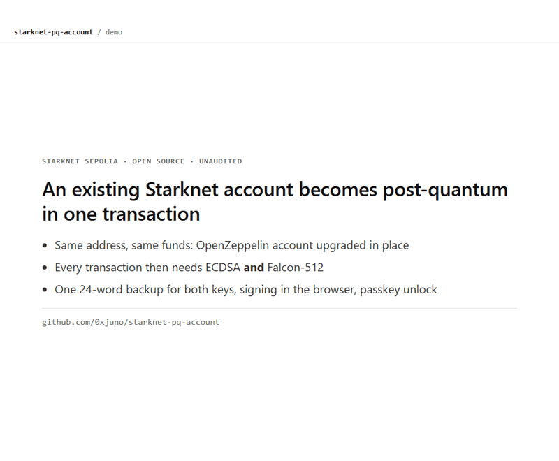
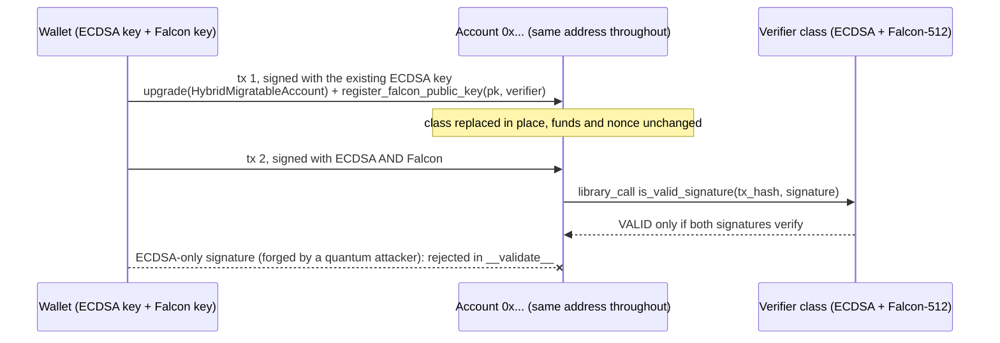

# starknet-pq-account

Move an existing Starknet account to post-quantum signatures without changing its address or
funds, back up both keys with one mnemonic, and sign from the browser.

> **Experimental. Unaudited. Testnet only.** Do not hold real funds with these contracts.

**Try it:** [johyeonchae.github.io/starknet-pq-account](https://johyeonchae.github.io/starknet-pq-account/)
and press "Use the public demo account". The page restores both keys inside the tab and sends a
hybrid-signed Sepolia transfer.



## Why

StarkWare's own assessment of Starknet accounts:

- "Standard Starknet accounts still sign with elliptic-curve cryptography." ... "Account signing is
  only demonstrated. Its implementations are unaudited, and an ordinary user can't adopt it yet."
  ([StarkWare, 2026-10-13](https://starkware.co/blog/what-chains-can-become-post-quantum/))
- "Existing accounts do not change automatically. Wallet support, signing, key management,
  recovery, custody, audits and adoption remain separate work." "Wallet and custody teams decide
  whether to integrate it." ([StarkWare migration register](https://quantum.starkware.co/migration-register))
- "Starknet accounts can swap their verification logic in place, with the same address and same
  assets" ([StarkWare, 2026-07-20](https://starkware.co/blog/starknets-quantum-edge-starks-and-native-account-abstraction/))

This repository is a working prototype of that migration path for ordinary accounts: the
in-place upgrade, the hybrid signature check, key backup and recovery, and browser signing.

## What is here

| Piece | What it does |
| --- | --- |
| `HybridMigratableAccount` | Thin account class for in-place migration of an existing OpenZeppelin account. Keeps the OZ storage key `Account_public_key`, registers a Falcon key, and library-calls a declared verifier class. The verifier, the Falcon key and the ECDSA key can each be replaced later by a hybrid-signed self-call. |
| `HybridPoseidonAccount`, `HybridShakeAccount` | Full hybrid accounts, also used as verifier classes: a transaction passes only if BOTH a STARK-curve ECDSA signature and a Falcon-512 signature verify over the same hash. |
| Key backup profile | One BIP39 mnemonic restores both keys. See [`contracts/docs/key-backup-v0.md`](contracts/docs/key-backup-v0.md). |
| Browser signer | Falcon-512 signing in the browser with [@noble/post-quantum](https://github.com/paulmillr/noble-post-quantum) (pure JS), converted by `signer/falcon_adapter.mjs` into the layout of the standard SHAKE-256 on-chain verifier. Demo page: [`docs/index.html`](docs/index.html). |
| Passkey lock | After one restore from the words, the page can lock the 64-byte seed with a passkey: AES-GCM under a key derived (HKDF-SHA256) from the passkey's WebAuthn PRF output, stored in that browser only. Later visits unlock with Face ID, fingerprint, Windows Hello or a security key; the words stay the backup. |
| Demo scripts | Sepolia scripts for deployment, migration, negative tests, backup/recovery and the browser path (`signer/`). |

## How migration works



The two calls run in one transaction, so there is no moment where the account is upgraded but
unprotected. If an account is upgraded without registering a key, it only accepts a single
ECDSA-signed `register_falcon_public_key` self-call.

## Threat model

| Threat | Covered | How |
| --- | --- | --- |
| A quantum attacker derives the account's ECDSA key | Yes | Every transaction also needs the Falcon-512 signature. |
| A flaw in the Falcon implementation or in lattice assumptions | Yes | Every transaction also needs the classical ECDSA signature. |
| Lost device or key files | Yes | One 24-word mnemonic restores both keys. |
| Someone else swaps the verifier, rotates keys or upgrades the class | Yes | All of these are self-calls that need a hybrid-signed transaction. |
| Bridges (StarkGate, BTC wrappers), Ethereum settlement, data availability | No | Outside the account; see StarkWare's migration register. |
| Bugs in this code | No | Unaudited. Testnet only. |

## Cost on mainnet

Gas measured on Sepolia, priced with the latest Starknet mainnet block on 2026-10-16
(L2 gas price 11.34 x 10^9 fri, STRK at $0.0775):

| Transfer from | L2 gas | Fee |
| --- | --- | --- |
| OpenZeppelin ECDSA account (baseline) | 1.85M | 0.021 STRK, about $0.002 |
| Migrated hybrid account, Poseidon Falcon verifier | 15.8M | 0.18 STRK, about $0.014 |
| Migrated hybrid account, standard SHAKE-256 verifier (browser path) | 53.9M | 0.61 STRK, about $0.047 |

Reproduce with `node signer/mainnet_cost.mjs`.

## Results on Starknet Sepolia

| Step | Transaction |
| --- | --- |
| Hybrid account deploy (deploy tx itself hybrid-signed) | [0x18e2ed9d…](https://sepolia.voyager.online/tx/0x18e2ed9d992074cb618cc03b40618bf4de8cd7a057906ede5b96c00d46ce070) |
| In-place migration of an existing OZ account (same address) | [0x75b5c5e2…](https://sepolia.voyager.online/tx/0x75b5c5e20cb189d72f228d033627c863f781b930df07fefefc3f548186aeef0) |
| Hybrid-signed transfer after migration | [0x521ff2b3…](https://sepolia.voyager.online/tx/0x521ff2b341561abb0bc71581a4feaf650311bf0398176b5d7f1dc2c16343d57) |
| Transfer signed with keys restored from the mnemonic | [0x3ba4e173…](https://sepolia.voyager.online/tx/0x3ba4e17369011649b2ec02b97df634dfd7cd417630853300fa94b2f80484c57) |
| Account migrated with the standard SHAKE-256 verifier | [0x32e8ca84…](https://sepolia.voyager.online/tx/0x32e8ca84a51b8c78ca2a625723ee2dc60aae771da6b8ce4e1ad99bbbaccfcdb) |
| Transfer signed in a browser (ECDSA + noble Falcon-512) | [0x75c5bffb…](https://sepolia.voyager.online/tx/0x75c5bffb108e430df5cb92f3b79ba22e419a1be5a75f231bfc15289b965dd80) |
| Public demo account migrated (class with key rotation) | [0x63b59d1c…](https://sepolia.voyager.online/tx/0x63b59d1cf42250241f1c855e633ab359b6a9b5fc1fd3b8c02c0d9a2ce3962c) |

- Migrated account [`0x54370be5…4c41`](https://sepolia.voyager.online/contract/0x54370be5a940849f13c01f269d95d06c57d15495da594f3e01dfb6eebdb4c41):
  balance before 3.974179 STRK, after 3.750300 STRK; the difference equals the migration fee exactly.
- ECDSA-only transfers from migrated accounts are rejected in `__validate__`.
- Declaring the thin migratable class costs about 4 STRK on Sepolia, against about 51 STRK for a
  full hybrid class, because verification is shared through a library call.
- Signatures from `@noble/post-quantum` were cross-checked against an independent Python
  computation and pass the Cairo SHAKE-256 verifier (`contracts/src/tests_browser.cairo`).
- Passkey lock, tested end to end in headless Edge with a CDP virtual authenticator (CTAP2,
  user verification, PRF): restore from words, lock, reload, unlock with the passkey, send
  ([0x70e467c5…](https://sepolia.voyager.online/tx/0x70e467c5c159390aea87a496b27f4bc69cb5b6462c6918d7050900eca7c8a67)).
  Reproduce with `node signer/passkey_e2e.mjs`.
- STRK20 privacy pool compatibility is analysed in
  [`contracts/docs/strk20-compatibility.md`](contracts/docs/strk20-compatibility.md); an end-to-end
  run still needs a Sepolia proving service.

### Public demo account

Sepolia only. These 24 words are published on purpose so anyone can try the page; the account
holds test STRK with no value and is refilled from time to time. Never paste a real wallet's words
into any web page.

```text
clip west volume icon sibling act dirt easily magnet fuel rigid robust lunar pause deer crisp reunion slogan wrist choice wisdom scene blossom salt
```

Account: [`0x343e3df5…c0db`](https://sepolia.voyager.online/contract/0x343e3df576edca452f2cc6ac5247fc38a3641912f545e25468e3b7e7de1c0db)
(the page fills the words in for you with "Use the public demo account").

## Limits

- Unaudited. The Poseidon Falcon variant uses a Poseidon hash-to-point (cheap, non-standard); the
  SHAKE-256 variant follows the standard and costs about 3.4x the gas.
- After migration, OpenZeppelin extras such as SRC-9 outside execution (paymasters, session keys)
  are not available yet.
- The passkey lock needs the WebAuthn PRF extension. Support differs by device, browser and
  password manager; it was tested with a Chromium virtual authenticator, not yet across real
  devices. Hardware wallet signing is open.
- The passkey protects the stored seed on one device; it does not replace the on-chain ECDSA key.
  Using the passkey itself as the classical signer (secp256r1) is a possible next step.
- Key backup reproducibility is tied to the pinned Falcon library (see the backup doc).

## Quickstart

Requirements: Scarb 2.18.0, Node.js 20+ (24 for the STRK20 SDK), Python 3.11+ with `numpy`,
`pycryptodome` and `beartype`, and a [falcon.py](https://github.com/tprest/falcon.py) checkout at
commit `5145a818c9512b4a443507d3375e75dae3076af6`.

```sh
cd contracts
scarb build
scarb cairo-test          # 38 tests

cd ../signer
npm install
# set FALCON_PY_DIR to the falcon.py checkout (PQ_PYTHON, PQ_KEYS_DIR, PQ_RPC are optional)
node setup_keys.mjs     # testnet keys under .keys/ (gitignored); fund the printed address
                        # from the official faucet https://faucet.starknet.io
node demo.mjs           # declare + deploy a hybrid account, hybrid transfer
node migrate_demo.mjs   # migrate an OZ account in place
node backup_demo.mjs    # mnemonic backup and recovery
node browser_signer_check.mjs   # offline: noble signature vs Python vs Cairo fixture
node browser_setup.mjs  # SHAKE verifier + account for the browser demo (docs/index.html)
node mainnet_cost.mjs   # fee per transfer at current mainnet prices
node passkey_e2e.mjs    # demo page + virtual passkey: lock, reload, unlock, send (Chromium)
```

## Credits

Built on [OpenZeppelin cairo-pq-verifiers](https://github.com/OpenZeppelin/cairo-pq-verifiers)
(MIT), [falcon.py](https://github.com/tprest/falcon.py) (MIT) and
[@noble/post-quantum](https://github.com/paulmillr/noble-post-quantum) (MIT). See
[NOTICE.md](NOTICE.md). License: MIT.
